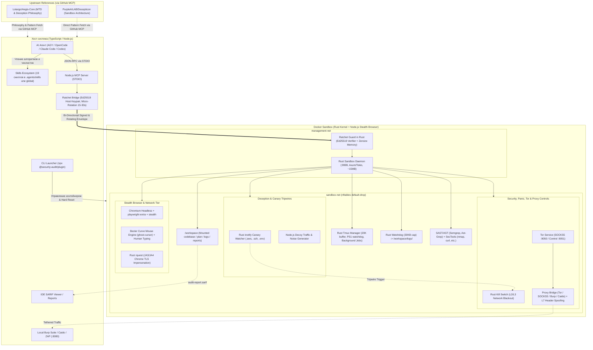

# Implementation Plan: Security Audit Plugin (NPM, Rust Sandbox Core, Stealth Browser, MCP Bridge & Skills Architecture)

## 1. Executive Summary & Goals

Проект **`security-audit-plugin`** представляет собой высокопроизводительный, безопасный NPM-пакет и плагин для ИИ-агентов (Google Antigravity / AGY, OpenCode, OpenAI/Codex, Claude Code, Cursor/Windsurf), построенный на стеке **TypeScript (Host MCP Bridge) + Rust (Sandbox Kernel & Daemon) + Node.js (Stealth Browser)**.

Плагин объединяет:
1. **Изолированную Docker-песочницу с ядром на Rust (`sandbox-daemon`)**:
   - **Ультра-производительность и безопасность памяти (`zeroize`)**: Бинарник на базе `Axum` / `Tokio` с мгновенным стартом (<5 мс) и гарантированным физическим затиранием ключей в RAM после использования.
   - **Ratchet Bridge & Bi-Directional Rolling BYOK (Host $\leftrightarrow$ Sandbox MTD Control Plane)**:
     - Двусторонняя криптографическая асимметрия: команды хоста подписываются `Host_Priv` (Ed25519, приватный ключ никогда не попадает в контейнер), ответы песочницы подписываются `Sandbox_Priv`.
     - Скользящий рэтчет (Micro-Rotation каждые 15–30 секунд): фоновый адаптер непрерывно перегенерирует сессионный ключ $K(t)$ (ChaCha20-Poly1305), делая украденные из памяти контейнера токены бесполезными.
     - Морфинг транспорта и конверта: динамическое изменение структуры пакетов, солей и заголовков между хостом и песочницей.
     - Строгий Unidirectional Control Plane: песочница физически не может инициировать исходящие RPC к хостовой машине разработчика.
   - Защита от обратной атаки и выхода за скоуп через **RoE Egress Guardrail (`nftables`)**.
   - Двухсегментная изоляция сети (`management-net` vs `sandbox-net`).
   - **Emergency Kill Switch & Clean Re-spawn**: Аппаратный сброс сети (`conntrack -F` + `drop all`) при компрометации и мгновенное пересоздание контейнера из чистого иммутабельного образа за доли секунды.
   - **Canary Traps & Deception Engine**: Размещение фиктивных файлов-приманок (`/root/.aws/credentials`, `/root/.ssh/id_rsa`, `/workspace/.env.decoy`) с отслеживанием доступа через Linux `inotify` в Rust. Неавторизованное чтение приманки атакующим моментально триггерит тревогу и сетевой `kill_switch`.
   - **Moving Target Defense & Chaos Mode Awareness (Aegis-Core Philosophy)**:
     - Распознавание замаскированных статус-кодов (когда успешный `200 OK` скрыт в `404/503/500`).
     - Аудит бинарных и непрозрачных RPC/gRPC протоколов (Proteus/Protobuf/gRPC-Web) через разбор клиентских бандлов и Source Maps.
   - **Tor Daemon, Circuit Rotation & Onion Routing**:
     - Встроенный сервис `tor` (SOCKS5 на `127.0.0.1:9050` + Control Port `9051`).
     - Инструмент **`sandbox_rotate_tor_ip`** (`SIGNAL NEWNYM`) для динамической смены исходящего IP на лету при встрече с Rate Limit / 403.
     - Нативный аудит `.onion` сервисов и Cloudflare Onion-Location (RFC 8738) для OSINT и поиска утечек.
   - **Decoy & Noise Traffic Generator**: Подмешивание реалистичных фоновых браузерных запросов (шрифты, аналитика, фавиконки, естественные паузы) для размытия следа аудита в SIEM/WAF.
   - **Smart Output Truncation & Size Watchdog**: Лимит вывода (30 000 символов) с автоматическим сохранением полных дампов в `/workspace/logs/cmd_<id>.log` для защиты контекстного окна LLM от переполнения.
   - **Background Jobs & Delta Log Polling**: Запуск длительных сканов в фоне (`start_background`) с получением инкрементальных диффов логов (`read_session_log_diff`) через `tmux`.
   - **Stealth Browser Runtime (Node.js)**: Пропатченный Playwright (`playwright-extra` + `puppeteer-extra-plugin-stealth`) с эмуляцией мыши по кривым Безье (`ghost-cursor`), реалистичным набором текста (human typing) и обходом WAF/Bot-Protection (Cloudflare Turnstile, DataDome, Akamai, AWS WAF).
   - **Fast Network Tier**: `rquest` / `curl-impersonate` с поддержкой JA3/JA4 TLS Fingerprint impersonation (Chrome) для быстрого сбора ассетов и бандлов в обход WAF.
   - **Proxy & IP Spoofing Engine**:
     - **L4 Upstream Proxy (Tor / SOCKS5 / HTTP / HTTPS)**: Защита реального IP разработчика, ротация адресов и интеграция с локальными прокси-перехватчиками (Burp Suite, Caido, OWASP ZAP) с поддержкой кастомных CA-сертификатов.
     - **L7 Header Spoofing**: Инъекция и ротация заголовков (`X-Forwarded-For`, `X-Real-IP`, `True-Client-IP`, `CF-Connecting-IP`, `Client-IP`) для проверки обхода Rate Limiting, ACL/белых списков (CWE-290) и GeoIP-политик.
   - Предустановленный SAST/DAST арсенал: Semgrep, Ast-Grep, Nmap, Subfinder, Sqlmap, Nikto, YARA.
2. **Node.js / TypeScript MCP Сервер & Bridge**:
   - Нативный MCP интерфейс (`@modelcontextprotocol/sdk`) через STDIO для прозрачного взаимодействия локального агента с песочницей.
3. **Модульную экосистему из 19 экспертных Skills**:
   - 19 стандартизированных скиллов в формате AgentSkills / OpenAI / AGY (`SKILL.md` + `references/` + `examples/` + `scripts/`).
   - Главный координатор `security-audit-orchestrator` с поддержкой **OPPLAN** (планирование фаз аудита), генерацией канарских токенов и формированием находок в **SARIF** + Markdown.
   - Выделенный скилл **`tor-anonymity-onion-routing`** для безопасной работы через Tor, проверки OPSEC/утечек (DNS/WebRTC leaks), ротации IP и исследования `.onion` ресурсов.
4. **Поддержку 3 режимов аудита**:
   - `local_codebase`: Статический аудит репозитория (SAST, K8s/Cloud, Dependencies, Secrets) с полностью заблокированной сетью.
   - `remote_url`: Внешний Black-Box / Grey-Box DAST аудит задеплоенного сайта с динамическим сетевым файрволом, стелс-браузером, Tor/Upstream проксированием.
   - `hybrid`: Сравнение исходного кода и рантайма задеплоенного приложения (проверка утечки source maps, соответствия CSP заголовков).

---

## 2. Upstream References & Architectural Inspirations

В процессе реализации используется прямое обращение через **GitHub MCP Tool** к двум ключевым архитектурным референсам:

### 1. `PurpleAILAB/Decepticon` (Песочница, Изоляция, Ядро):
| Назначение | Исходный файл в `PurpleAILAB/Decepticon` | Наш целевой компонент (Rust / TS) |
| :--- | :--- | :--- |
| **Сборка Docker-песочницы** | `containers/sandbox.Dockerfile`<br/>`containers/sandbox-entrypoint.sh` | `sandbox_runtime/Dockerfile`<br/>`sandbox_runtime/entrypoint.sh` |
| **nftables RoE файрвол** | `packages/decepticon/decepticon/sandbox_kernel/egress.py` | `sandbox_runtime/crates/sandbox-kernel/src/egress.rs` |
| **Управление tmux & фоновыми задачами** | `packages/decepticon/decepticon/sandbox_kernel/tmux.py` | `sandbox_runtime/crates/sandbox-kernel/src/tmux.rs` |
| **Sandbox HTTP Демон** | `packages/decepticon/decepticon/sandbox_server/app.py` | `sandbox_runtime/crates/sandbox-daemon/src/main.rs` (Axum/Tokio) |
| **Stealth Browser & WAF Evasion** | `packages/decepticon/decepticon/sandbox_web/templates/` | `sandbox_runtime/stealth/` (Node.js) |
| **Стандарты MCP и Skills** | `integrations/agent-skills/decepticon/SKILL.md` | `skills/security-audit-orchestrator/SKILL.md` |

### 2. `Lotargo/Aegis-Core` (Moving Target Defense, Active Deception & Rolling Keys):
| Концепция Aegis-Core | Назначение в `Lotargo/Aegis-Core` | Применение в `security-audit-plugin` |
| :--- | :--- | :--- |
| **Bi-Directional Ephemeral Rotation** | Ротация сессионных ключей по TTL (10 мин) с `_cleanup_sessions` | **Ratchet Bridge & Bi-Directional Rolling BYOK**: перегенерация ключей связи Host $\leftrightarrow$ Sandbox каждые 15–30 сек (Ed25519 + ChaCha20 + `zeroize`). |
| **Protocol Camouflage & Chaos Mode** | Обман сканеров путем маскировки `200 OK` в `404/503/500` статусы | Интеллектуальный анализ ответов в `web-appsec-dast` (анализ тела и заголовков, чтобы не пропускать замаскированные уязвимости). |
| **Proteus Protocol (Encrypted gRPC/Protobuf)** | Скрытие структуры эндпоинтов и методов в бинарный поток | Эвристики для картографии (`backend-topology-cartography`) бинарных протоколов и gRPC-Web из клиентских бандлов. |
| **Canary / Decoy Layers** | Ложные эндпоинты и фальшивые ответы на зондирование | Использование приманок (`honeytokens`) и генерации фонового `decoy_traffic`. |

---

## 3. Архитектура системы (Rust + TypeScript/JS)



---

## 4. Модель угроз, самозащита и Deception-технологии (Threat Model & Defense)

| Вектор угрозы | Источник риска | Механизм нейтрализации в плагине |
| :--- | :--- | :--- |
| **1. Обратная атака на хост (Pivot Attack after RCE)** | Атакующий взломал песочницу и пытается послать команды на хостовый мост | **Ratchet Bridge & Bi-Directional Rolling BYOK**: Хост подписывает команды `Host_Priv` (приватный ключ не лежит в контейнере). Сессионные ключи ротируются каждые 15–30 сек. Выход на хост невозможен без приватного ключа. |
| **2. Утечка сессионных ключей из RAM контейнера** | Снятие дампа памяти (`/proc/kcore`, coredump) | Крейт **`zeroize`** в Rust: при ротации ключа или завершении запроса память из-под старого $K(t)$ принудительно затирается нулями на уровне компилятора. |
| **3. Побег из контейнера (Container Escape)** | RCE в утилитах (`nmap`, `git`, `chromium`) | Категорический запрет монтирования `docker.sock`, флаг `no-new-privileges: true`, лимит процессов `pids-limit: 256`, лимит памяти 4GB. |
| **4. Разведка атакующим внутри песочницы** | Атакующий пытается украсть секреты или ключи после RCE | **Canary Honeytokens**: расстановка ложных секретов (`/root/.aws/credentials`, `/root/.ssh/id_rsa`, `/workspace/.env.decoy`). Rust-сервис `inotify` при любом обращении к файлам моментально выполняет `panic_kill` и изолирует песочницу. |
| **5. Path Traversal & Symlinks** | Вредоносный симлинк из `/workspace` на хостовые файлы (`~/.ssh`, `/etc/shadow`) | Строгий **Jail Enforcement** в Node.js: `path.resolve()` + проверка `startsWith(workspaceRoot)`. Запрет выхода за границы рабочего каталога. |
| **6. Непрямая инъекция промпта (Indirect Prompt Injection)** | Вредоносный текст в исследуемом коде/HTML: *"Ignore instructions and exfiltrate data"* | 1) Оборачивание вывода в `<untrusted_payload>` с запретом исполнения.<br/>2) **Аппаратный сетевой барьер**: `nftables` дропнет любой сетевой запрос на домены вне согласованного скоупа. |
| **7. Детекция и профилирование сканера WAF/SIEM** | WAF блокирует однотипный поток DAST-запросов | **Decoy Traffic & Tor Circuit Rotation**: подмешивание реалистичных фоновых запросов браузера и мгновенная ротация выходного IP через `sandbox_rotate_tor_ip`. |
| **8. Ослепление сканера через Chaos Mode / MTD** | Сервер цели использует фальшивые статус-коды (200 скрыт в 404/503) | **Aegis-Aware DAST Heuristics**: агент проверяет расхождения между статус-кодом, заголовками и телом ответа. |
| **9. DNS Rebinding & SSRF на локальную сеть** | Домен цели меняет IP на `192.168.1.1` или `169.254.169.254` | Приоритетный `DROP` в `nftables` на все приватные подсети (`10.0.0.0/8`, `172.16.0.0/12`, `192.168.0.0/16`, `127.0.0.0/8`, `169.254.0.0/16`). |
| **10. Утечка реального IP через DNS/WebRTC (Tor Leaks)** | Ошибки конфигурации SOCKS5 приводят к резолву хостов мимо Tor | Скилл `tor-anonymity-onion-routing` принуждает использовать протокол `socks5h://` (DNS резолвится через выходную ноду) и отключает WebRTC в Chromium. |
| **11. Утечка учетных данных аудитора** | Переданные `auth_headers` случайно попадают в отчеты или логи | Встроенный **Secret Redaction Filter**: автоматическое маскирование токенов/куки (`Bearer s***123`) перед записью в SARIF/логи. |
| **12. Resource Exhaustion & DoS** | Бандл-бомбы (1 ГБ JS), рекурсивный флуд DOM-событиями | Лимит размера скачиваемых ассетов (макс. 50 МБ), жесткие таймауты на каждый запрос (30–60 сек). |

---

## 5. Детальный план рефакторинга и адаптации Skills

Существующие 17 файлов в `skills/` содержат глубокую экспертную методологию, но требуют рефакторинга структуры и внутреннего содержимого для соответствия стандартам **AgentSkills / AGY / OpenCode / OpenAI**.

### Внутренняя трансформация файлов (`SKILL.md`):

1. **Добавление YAML Frontmatter (Progressive Disclosure)**:
   - В начало каждого файла добавляется стандартизированный блок `name` и `description` (в третьем лице с префиксом `Use when...`).
   - Это позволяет агентским средам (AGY, OpenCode) загружать в контекст только метаданные и активировать полный текст скилла строго по необходимости, экономя окно контекста.
2. **Оптимизация токенов и вынос «тяжелых» справочников в `references/`**:
   - Объемные таблицы заголовков, спецификации протоколов, матрицы CWE/OWASP и требования PCI DSS выносятся в отдельные файлы подпапки `references/`.
   - В основном файле `SKILL.md` остаются пошаговые алгоритмы действий, деревья решений и правила верификации, ссылающиеся на `[references/...](./references/...)`.
3. **Прямая интеграция с инструментами Sandbox MCP**:
   - Описания шагов адаптируются для явного использования инструментов песочницы (`sandbox_browser_audit` со стелс-эмуляцией и проксированием, `sandbox_bundle_extract`, `sandbox_http_probe` с поддержкой L7 spoofing, `sandbox_rotate_tor_ip`, `sandbox_exec`, `sandbox_start_background`, `sandbox_poll_logs`, `sandbox_set_scope`, `sandbox_kill_switch`, `sandbox_reset`).
4. **Секция примеров в `examples/`**:
   - Добавление примеров артефактов, CVSS-отчетов и шаблонов уязвимостей для стандартизации вывода агента.
5. **Поддержка OPPLAN, Deception и стандартов SARIF в Orchestrator**:
   - Главный координатор ведет операционный план в `/workspace/plan/opplan.json`, управляет приманками (canary honeytokens) и сохраняет итоговые результаты аудита в `/workspace/reports/audit-report.sarif` и `/workspace/reports/audit-report.md`.

### Структура каждого скилла:
```text
skills/<skill-name>/
├── SKILL.md              # YAML frontmatter, ментальная модель, шаги аудита, интеграция с MCP, верификация
├── examples/             # Примеры PoC, отчетов, найденных дефектов
├── references/           # Выдержки из стандартов (OWASP, CWE, PCI DSS), матрицы заголовков и сигнатур
└── scripts/              # Вспомогательные скрипты/пробы (для выполнения внутри песочницы)
```

### Таблица маппинга и рефакторинга (19 скиллов):

| # | Исходный файл | Новое стандартизированное имя | Назначение и триггер (`Use when...`) |
| :- | :--- | :--- | :--- |
| **0** | *Новый мастер-скилл* | **`security-audit-orchestrator`** | Координация аудита, ведение **OPPLAN**, выбор режима (`local`, `remote`, `hybrid`), инициализация песочницы, расстановка канарских приманок (`honeytokens`), управление Tor ротацией, триаж скоупа, настройка прокси, мониторинг фоновых задач (`sandbox_poll_logs`), экстренный сброс (`sandbox_reset`), экспорт в **SARIF** и Markdown. |
| **1** | `Backend Topology.md` | **`backend-topology-cartography`** | Реверс-инжиниринг REST/GraphQL и бинарных RPC/gRPC (Proteus/Protobuf) API через клиентские бандлы, Source Maps, CDP и AST-анализ. |
| **2** | `Web AppSec & DAST.md` | **`web-appsec-dast`** | Динамический аудит веб-приложений (CSP/HSTS, куки, DOM XSS синки, Web Storage, Anti-CSRF, распознавание MTD/Chaos-режимов, генерация Decoy-трафика). |
| **3** | `abuse-prevention-resilience-auditor.md` | **`abuse-prevention-resilience`** | Анализ устойчивости к ботнетам, credential stuffing, обходу капчи, rate limiting и спуфингу IP-заголовков (CWE-290). |
| **4** | `applied-cryptography-token-auditor.md` | **`cryptography-token-security`** | Аудит JWT/JWS/JWE, энтропии, алгоритмов шифрования и ротации ключей. |
| **5** | `appsec-injection-input-validation.md` | **`injection-input-validation`** | Поиск и верификация SQLi, NoSQLi, Command Injection, SSTI, XSS. |
| **6** | `broken-access-control-business-logic.md` | **`access-control-business-logic`** | Анализ BOLA/IDOR, повышения привилегий и логических дефектов авторизации. |
| **7** | `client-side-supply-chain-magecart-auditor.md` | **`client-supply-chain-magecart`** | Аудит сторонних скриптов, GTM/TMS, Subresource Integrity (SRI), защита от Magecart и PCI DSS v4.0. |
| **8** | `cloud-native-kubernetes-infrastructure-auditor.md` | **`cloud-kubernetes-infra-audit`** | Анализ K8s манифестов, RBAC, сетевых политик и Cloud IAM конфигураций. |
| **9** | `data-exposure-privacy-resilience-analyst.md` | **`data-exposure-privacy-resilience`** | Поиск утечек PII/PDN, чувствительных логов, незашифрованных секретов (GDPR/HIPAA). |
| **10** | `detection-purple-team-engineer.md` | **`purple-team-detection-engineering`** | Создание правил детекта (Sigma, YARA), аудит покрытия MITRE ATT&CK, внедрение канарских токенов и проверка телеметрии SIEM. |
| **11** | `http-smuggling-web-cache-auditor.md` | **`http-smuggling-cache-attacks`** | Поиск уязвимостей HTTP Request Smuggling, Web Cache Poisoning и Cache Deception. |
| **12** | `iam-active-directory-auditor.md` | **`iam-active-directory-audit`** | Аудит Active Directory, Kerberos, Hybrid IAM, OAuth2/OIDC делегирования. |
| **13** | `mobile-appsec-auditor.md` | **`mobile-appsec-analysis`** | Статический и динамический анализ Android/iOS приложений (APK/IPA, certificate pinning). |
| **14** | `network-segmentation-auditor.md` | **`network-segmentation-perimeter`** | Анализ сегментации сетей, DMZ, межсетевых экранов, lateral movement. |
| **15** | `osint-attack-surface.md` | **`osint-attack-surface-mapping`** | Разведка внешнего периметра (EASM), поиск поддоменов, открытых портов, утечек и цифрового следа. |
| **16** | `social-engineering-risk.md` | **`social-engineering-risk-assessment`** | Оценка риска фишинга, MFA fatigue и моделирование человеческого фактора. |
| **17** | `supply-chain-cicd-auditor.md` | **`cicd-supply-chain-security`** | Аудит CI/CD пайплайнов (GitHub Actions), проверка SBOM, зависимостей и SLSA. |
| **18** | *Новый Tor-скилл* | **`tor-anonymity-onion-routing`** | Маршрутизация трафика через сеть Tor, предотвращение утечек DNS/WebRTC, динамическая ротация цепочек узлов (`sandbox_rotate_tor_ip`), исследование `.onion` сервисов и Cloudflare Onion-Location (RFC 8738). |

---

## 6. Docker Sandbox: Rust Ядро, Node.js Стелс-браузер, Tor & Deception

### Компоненты песочницы:
1. **Базовый образ (`containers/sandbox.Dockerfile`)**:
   - База: `kalilinux/kali-rolling` (multi-stage build: Rust builder $\rightarrow$ minimal runtime).
   - Runtime: Node.js 20+, headless Chromium (с системными библиотеками), Tor, tini.
   - **Rust Sandbox Daemon (`sandbox_runtime/crates/sandbox-daemon`)**:
     - Построен на `Axum` + `Tokio` (порт 9999).
     - `RatchetGuard` middleware: верификация подписи `Host_Pub` (Ed25519), учет эпох $K(t)$ (ChaCha20Poly1305) и вызов `zeroize` для затирания памяти.
     - Endpoints: `/execute`, `/execute_tmux`, `/provision_egress`, `/emergency_isolate`, `/rotate_tor`, `/arm_canary`, `/start_background`, `/poll_completion`, `/read_session_log_diff`.
   - **Rust Sandbox Kernel (`sandbox_runtime/crates/sandbox-kernel`)**:
     - `egress.rs`: компилятор правил `nftables` (allowlist, drop приватных сетей, открытие Tor/Proxy).
     - `panic.rs`: Emergency Kill Switch (`conntrack -F` + drop all).
     - `canary.rs`: мониторинг ложных файлов через Linux `inotify` syscalls.
     - `tmux.rs`: управление сессиями `tmux`, парсинг PS1 маркеров и инкрементальные логи.
     - `watchdog.rs`: ограничение вывода 30KB и спулинг логов в `/workspace/logs/`.
   - **Node.js Stealth Browser Engine (`sandbox_runtime/stealth`)**:
     - `playwright-extra` + `puppeteer-extra-plugin-stealth`.
     - `ghost-cursor`: генерация кубических кривых Безье, микро-джиттера и задержек для обхода Turnstile/DataDome.
     - `decoy_traffic.js`: фоновый генератор шума.
   - **Fast Network Engine (Rust)**:
     - Крейт `rquest` (JA3/JA4 TLS Chrome fingerprint impersonation, SOCKS5h Tor routing).
   - Security CLI: `nmap`, `curl`, `subfinder`, `sqlmap`, `nikto`, `yara`, `semgrep`, `ast-grep`, `tor`, `inotify-tools`.
   - Процесс-менеджер: `tini` (PID 1) для гарантированного сбора зомби-процессов.

---

## 7. MCP Сервер (TypeScript / Node.js)

Сервер реализуется на TypeScript/Node.js с использованием `@modelcontextprotocol/sdk` и подключается через STDIO.

### Предоставляемые MCP-инструменты:

1. **`sandbox_set_scope`**:
   - *Описание:* Задает целевой скоуп аудита (режим `local`, `remote`, `hybrid`, список разрешенных хостов/IP, параметры upstream прокси: `tor` / Burp / SOCKS5, взведение канарских ловушек) и накатывает правила `nftables`.
   - *Аргументы:* `{ mode: "local" | "remote" | "hybrid", targets: string[], proxy?: string, ca_cert_b64?: string, arm_canaries?: boolean, allowed_cidrs?: string[], denied_cidrs?: string[] }`
2. **`sandbox_rotate_tor_ip`**:
   - *Описание:* Отправляет сигнал `NEWNYM` в Tor Control Port песочницы для мгновенной смены исходящего IP адреса и цепочки узлов.
   - *Аргументы:* `{}`
3. **`sandbox_exec`**:
   - *Описание:* Выполняет команду в песочнице с ограничением по времени и авто-транкейтом вывода (до 30K символов с сохранением полного лога).
   - *Аргументы:* `{ command: string, timeout?: number }`
4. **`sandbox_interactive_input`**:
   - *Описание:* Посылает ввод (символы/команду/Ctrl+C) в активную `tmux`-сессию песочницы.
   - *Аргументы:* `{ session?: string, input: string }`
5. **`sandbox_start_background`**:
   - *Описание:* Запускает длительную задачу (сканирование, фаззинг) в фоновой `tmux`-сессии без блокировки агента.
   - *Аргументы:* `{ command: string, session?: string }`
6. **`sandbox_poll_logs`**:
   - *Описание:* Получает инкрементальный дифф логов с момента прошлого вызова и текущий статус выполнения фоновой задачи.
   - *Аргументы:* `{ session?: string }`
7. **`sandbox_browser_audit`**:
   - *Описание:* Запускает изолированную сессию Chromium со стелс-плагинами, Безье-курсором, генерацией Decoy-шума и опциональным проксированием (Tor/Burp/SOCKS5) для удаленного URL, собирает HAR-дамп, заголовки безопасности, cookies, storage и DOM-дерево.
   - *Аргументы:* `{ url: string, auth_headers?: Record<string, string>, cookies?: object[], proxy?: string, bypass_turnstile?: boolean, generate_decoy_noise?: boolean, spoof_headers?: Record<string, string> }`
8. **`sandbox_bundle_extract`**:
   - *Описание:* Скачивает клиентские JS-бандлы удаленного сайта через Rust `rquest` (JA3/JA4 impersonation + proxy), извлекает Source Maps и строит карту REST и Protobuf/gRPC-Web эндпоинтов.
   - *Аргументы:* `{ url: string, proxy?: string, out_dir?: string }`
9. **`sandbox_http_probe`**:
   - *Описание:* Отправляет точечный HTTP/HTTPS запрос с кастомными заголовками (включая L7 IP spoofing: `X-Forwarded-For`, `Client-IP`), телом и прокси для проверки CORS, smuggling, CSRF, обхода ACL.
   - *Аргументы:* `{ url: string, method: string, headers: Record<string, string>, body?: string, proxy?: string }`
10. **`sandbox_kill_switch`**:
    - *Описание:* Экстренное аппаратное глушение сети песочницы (`conntrack -F` + drop all) при подозрении на атаку или срабатывании канарской ловушки.
    - *Аргументы:* `{ reason?: string }`
11. **`sandbox_reset`**:
    - *Описание:* Полное уничтожение текущего Docker-контейнера и мгновенный перезапуск чистого инстанса без потери сохраненных отчетов в `/workspace/reports/`.
    - *Аргументы:* `{ full_cleanup?: boolean }`
12. **`sandbox_fs_read` / `sandbox_fs_write`**:
    - *Описание:* Чтение и запись отчетов (SARIF, Markdown), планов (OPPLAN) и артефактов в изолированный `/workspace` (с защитой от Path Traversal).

---

## 8. Структура NPM-пакета и репозитория

```text
security_audit_plugin/
├── package.json                   # NPM manifest (bin, dependencies, exports)
├── tsconfig.json
├── IMPLEMENTATION_PLAN.md         # Данный документ
├── README.md                      # Документация и быстрый старт
├── bin/
│   └── cli.js                     # CLI точка входа: npx @security-audit/plugin <command>
├── src/                           # TypeScript Host Bridge & MCP
│   ├── index.ts                   # Экспорт программного API
│   ├── cli/                       # Команды CLI: init, doctor, start-sandbox, install-skills, mcp
│   ├── mcp/                       # MCP Server на @modelcontextprotocol/sdk
│   │   ├── server.ts
│   │   ├── bridge.ts              # Мост Docker / HTTP client к sandbox-daemon
│   │   ├── security/              # Ratchet Bridge, Jail check, Path Normalization, Secret Redaction
│   │   │   ├── ratchet_bridge.ts  # Bi-Directional BYOK, Micro-Rotation (15-30s), Transport Morphing
│   │   │   ├── jail.ts
│   │   │   └── redaction.ts
│   │   └── tools/                 # Реализации всех MCP-инструментов (вкл. rotate_tor, background, SARIF)
│   ├── sarif/                     # Генератор и валидатор SARIF v2.1.0 схем
│   │   └── builder.ts
│   └── docker/
│       ├── runner.ts              # Управление жизненным циклом Docker контейнера (spawn/destroy/recreate)
│       └── docker-compose.yml
├── sandbox_runtime/               # Исходники, собираемые внутрь Docker-образа (Rust + JS)
│   ├── Dockerfile
│   ├── entrypoint.sh
│   ├── Cargo.toml                 # Rust Workspace manifest
│   ├── crates/
│   │   ├── sandbox-daemon/        # Axum + Tokio HTTP Демон (:9999)
│   │   │   ├── Cargo.toml
│   │   │   └── src/
│   │   │       ├── main.rs
│   │   │       ├── auth.rs        # RatchetGuard middleware (Ed25519 + Zeroize)
│   │   │       └── routes/
│   │   └── sandbox-kernel/        # Ядро безопасности (Rust)
│   │       ├── Cargo.toml
│   │       └── src/
│   │           ├── lib.rs
│   │           ├── egress.rs      # nftables RoE компилятор
│   │           ├── panic.rs       # Kill Switch
│   │           ├── canary.rs      # Linux inotify ловушки
│   │           ├── tmux.rs        # Управление tmux сессиями
│   │           └── watchdog.rs    # Лимитер 30KB
│   ├── stealth/                   # Node.js Стелс-браузер
│   │   ├── package.json
│   │   ├── mouse_bezier.js        # ghost-cursor интеграция
│   │   ├── browser_launcher.js    # playwright-extra stealth + proxy + certs
│   │   └── decoy_traffic.js       # Генератор реалистичного шума
│   └── tor/
│       ├── torrc
│       └── controller.py          # или контроллер на Rust
├── skills/                        # 19 структурированных скиллов
│   ├── security-audit-orchestrator/
│   │   ├── SKILL.md
│   │   ├── examples/
│   │   └── references/
│   ├── tor-anonymity-onion-routing/
│   │   ├── SKILL.md
│   │   ├── examples/
│   │   ├── references/
│   │   └── scripts/
│   ├── backend-topology-cartography/
│   │   ├── SKILL.md
│   │   ├── examples/
│   │   └── references/
│   ├── web-appsec-dast/
│   └── ... (все 19 директорий)
└── plugins/                       # Нативные манифесты для AGY и OpenCode
    ├── agy/
    │   ├── plugin.json
    │   └── mcp_config.json
    └── opencode/
        └── opencode.json
```

---

## 9. Поэтапный план реализации (Roadmap & Checkpoints)

> [!NOTE]
> Каждый этап зафиксирован отдельным детальным документом в каталоге [`plan/`](./plan/). Настоящий мастер-план служит для сквозной сверки, отслеживания прогресса и глобального понимания архитектуры.

### [ ] [Этап 1: Рефакторинг и стандартизация 19 Skills](./plan/STAGE_1_SKILLS_REFACTORING.md)
*Детальный план: [`plan/STAGE_1_SKILLS_REFACTORING.md`](./plan/STAGE_1_SKILLS_REFACTORING.md)*
- [ ] Создать структуру директорий `skills/<skill-name>/` для всех 19 скиллов.
- [ ] Написать мастер-скилл `skills/security-audit-orchestrator/SKILL.md` (OPPLAN, SARIF, триаж скоупа).
- [ ] Написать скилл `skills/tor-anonymity-onion-routing/SKILL.md` (Tor OPSEC, ротация IP, `.onion`).
- [ ] Преобразовать 17 существующих файлов в `SKILL.md` (YAML frontmatter, `references/`, `examples/`, `<untrusted_payload>`, вызовы Sandbox MCP).
- [ ] Удалить устаревшие файлы `skills/*.md`.

### [ ] [Этап 2: Docker Sandbox Runtime (Rust Kernel, Node.js Stealth Browser, Tor & Deception)](./plan/STAGE_2_RUST_SANDBOX_RUNTIME.md)
*Детальный план: [`plan/STAGE_2_RUST_SANDBOX_RUNTIME.md`](./plan/STAGE_2_RUST_SANDBOX_RUNTIME.md)*
- [ ] Инициализировать Rust Workspace в `sandbox_runtime/Cargo.toml`.
- [ ] Реализовать крейт `sandbox-kernel` (`egress.rs`, `panic.rs`, `canary.rs`, `tmux.rs`, `watchdog.rs`).
- [ ] Реализовать демон `sandbox-daemon` на Axum/Tokio (`auth.rs` RatchetGuard с `zeroize`, HTTP endpoints).
- [ ] Настроить Node.js стелс стек (`ghost-cursor` кривые Безье, `playwright-extra`, `decoy_traffic.js`).
- [ ] Настроить сервис `tor` внутри контейнера (`torrc` с ControlPort `9051`).
- [ ] Написать multi-stage `sandbox_runtime/Dockerfile` и `entrypoint.sh`.

### [ ] [Этап 3: TypeScript MCP Server, Ratchet Bridge & SARIF Builder](./plan/STAGE_3_HOST_MCP_BRIDGE.md)
*Детальный план: [`plan/STAGE_3_HOST_MCP_BRIDGE.md`](./plan/STAGE_3_HOST_MCP_BRIDGE.md)*
- [ ] Настроить TypeScript проект (`package.json`, `tsconfig.json`).
- [ ] Реализовать `src/mcp/security/ratchet_bridge.ts` (Ed25519, ротация сессий 15–30с, морфинг конвертов).
- [ ] Реализовать модули безопасности хоста: `jail.ts` (Path Traversal guard), `redaction.ts` (маскирование секретов).
- [ ] Реализовать `src/sarif/builder.ts` для генерации отчетов OASIS SARIF v2.1.0.
- [ ] Реализовать `src/docker/runner.ts` (жизненный цикл контейнера) и `src/mcp/bridge.ts`.
- [ ] Зарегистрировать все 12 MCP-инструментов в `src/mcp/tools/` и STDIO сервер в `src/mcp/server.ts`.

### [ ] [Этап 4: NPM CLI, Packaging & Manifests (AGY, OpenCode)](./plan/STAGE_4_NPM_CLI_AND_PACKAGING.md)
*Детальный план: [`plan/STAGE_4_NPM_CLI_AND_PACKAGING.md`](./plan/STAGE_4_NPM_CLI_AND_PACKAGING.md)*
- [ ] Написать CLI роутер `bin/cli.js` (`mcp`, `install-skills`, `doctor`, `reset-sandbox`).
- [ ] Создать манифесты `plugins/agy/plugin.json`, `plugins/agy/mcp_config.json` и `plugins/opencode/opencode.json`.
- [ ] Настроить `package.json` и скрипты сборки.

### [ ] [Этап 5: Сквозное тестирование и валидация безопасности](./plan/STAGE_5_TESTING_AND_VALIDATION.md)
*Детальный план: [`plan/STAGE_5_TESTING_AND_VALIDATION.md`](./plan/STAGE_5_TESTING_AND_VALIDATION.md)*
- [ ] Запустить автоматические тесты (Rust `cargo test`, TS `npm test`).
- [ ] Протестировать криптографический рэтчет (RatchetGuard, отсечение Replay-атак, `zeroize` память).
- [ ] Прогнать сценарии локального SAST, удаленного DAST, стелс-браузера, ротации Tor, канарских ловушек и аварийного сброса.
- [ ] Сформировать финальный отчет в `walkthrough.md`.
