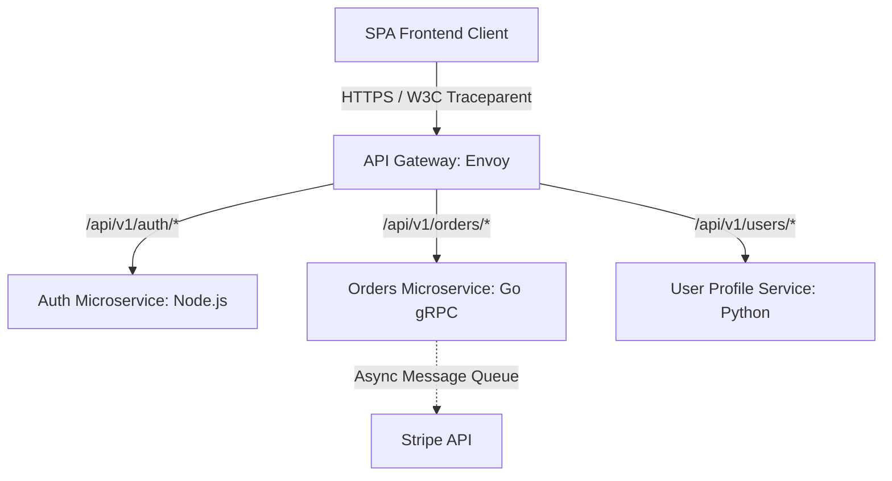

# Backend Topology Cartography Report: Example Service

## Discovered Microservices
1. **`auth-service`**: Handles session issuance, `/api/v1/auth/login`, `/api/v1/auth/refresh`.
2. **`orders-service`**: Internal gRPC service mapped via Envoy gRPC-Web bridge.
3. **`users-service`**: Exposes GraphQL sub-graph.
