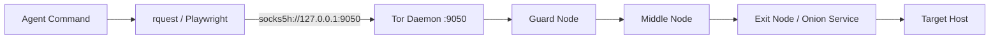

# Tor Anonymity & Onion Routing

## 1. Overview & OPSEC Principles

This skill governs network anonymization, dynamic IP rotation, and Tor v3 Onion service auditing. It ensures strict operational security (OPSEC), preventing host deanonymization through DNS resolution or WebRTC leaks.



---

## 2. Decision Workflow & Execution Rules

### Step 1: Pre-Flight OPSEC & Leak Verification
Always verify that network traffic routes through the Tor proxy before initiating any active probes:
```bash
# Verify Tor exit IP and ensure no direct DNS leaks
curl -s --socks5-hostname 127.0.0.1:9050 https://check.torproject.org/api/ip
```

> [!CAUTION]
> Always use `socks5h://` (or `--socks5-hostname`). Never use standard `socks5://` or direct DNS resolution, as this causes local DNS leak to ISP/Host resolvers.

### Step 2: Dynamic IP Rotation Protocol (WAF / Rate-Limit Evasion)
When receiving HTTP status codes `403 Forbidden` (Cloudflare/DataDome challenge) or `429 Too Many Requests`:
1. Call MCP tool `sandbox_rotate_tor_ip`.
2. The Rust kernel sends `AUTHENTICATE "" \r\n SIGNAL NEWNYM \r\n` to Tor ControlPort `9051`.
3. Wait 2.5 seconds for circuit establishment.
4. Retry the request with the new exit node.

### Step 3: Auditing Cloudflare Onion-Location & Hidden Services (RFC 8738)
When auditing public targets, inspect response headers for `Onion-Location`:
```http
HTTP/2 200 OK
Onion-Location: http://exampledotcom23456789abcdef.onion/
```
1. Validate whether the `.onion` counterpart endpoint mirrors production endpoints or exposes debug/management panels without WAF protections.
2. Probe hidden services directly through Tor SOCKS5 proxy.

---

## 3. Tool Integrations (Sandbox MCP)
- `sandbox_rotate_tor_ip`: Triggers instant circuit rotation via Tor ControlPort.
- `sandbox_http_probe`: Sends requests with `--proxy socks5h://127.0.0.1:9050`.
- `sandbox_browser_audit`: Launches Playwright with flags `--proxy-server=socks5://127.0.0.1:9050 --disable-webrtc`.

---

## 4. References & Examples
- [Tor OPSEC & Leak Checklist](./references/tor-opsec-checklist.md)
- [Tor v3 & RFC 8738 Onion-Location Specification](./references/onion-v3-spec.md)
- [IP Rotation Execution Log](./examples/ip-rotation-run.md)
- [Onion Service Exposure Audit Report](./examples/onion-leak-audit.md)
- [Tor Leak Check Script](./scripts/check_tor_leak.sh)
